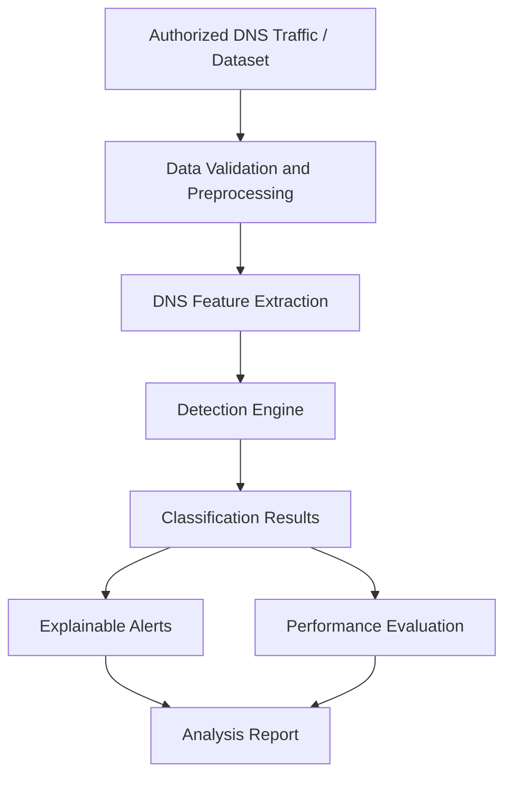

# 🔐 CipherTrace DNS
### Explainable Machine Learning-Based Detection of Covert Data Exfiltration Through DNS Traffic

<p align="center">
  <strong>Making Suspicious DNS Traffic Easier to Detect, Analyze, and Understand</strong>
</p>

<p align="center">
  
  
  
  
</p>

---

## 📌 Overview

**CipherTrace DNS** is a cybersecurity mini-project focused on identifying suspicious DNS traffic patterns that may indicate covert communication or potential data exfiltration.

The Domain Name System (DNS) is essential for translating domain names into IP addresses. However, attackers can abuse DNS queries and responses to transfer information through seemingly ordinary network activity. Such behavior can be difficult to distinguish from legitimate traffic using basic monitoring alone.

CipherTrace DNS aims to analyze DNS traffic characteristics, extract meaningful features, and apply machine learning techniques to help identify potentially suspicious behavior.

The project also emphasizes **explainable detection**, helping users understand why particular traffic patterns are flagged instead of relying only on a binary alert.

> **Project objective:** Develop a defensive analysis tool that combines DNS traffic feature extraction, anomaly detection, and interpretable results to support cybersecurity investigation.

## 🎯 Key Objectives

- Analyze DNS traffic to identify unusual query patterns.
- Extract statistical and structural features from DNS requests.
- Explore machine learning techniques for suspicious-traffic classification.
- Provide understandable explanations for detection results.
- Evaluate detection performance using appropriate classification metrics.
- Support security education and authorized network analysis.

## 🛡️ The Problem

DNS traffic is commonly used for legitimate network communication, but it can also be abused as a channel for covert data transfer.

Potential warning signs include:

- Unusually long domain names or subdomains.
- High-entropy strings that differ from typical domain naming patterns.
- Repeated DNS requests within a short period.
- Unusual distributions of characters in queried domain labels.
- Traffic patterns that differ significantly from an established baseline.

These characteristics are **indicators, not proof of malicious activity**. Legitimate applications can also produce unusual DNS traffic, so detection results require careful evaluation and interpretation.

## 💡 Proposed Solution

CipherTrace DNS follows a defensive analysis workflow:

1. **Traffic Input** — Load authorized DNS traffic from supported datasets or packet captures.
2. **Preprocessing** — Validate, clean, and normalize the input data.
3. **Feature Extraction** — Calculate relevant DNS query characteristics.
4. **Detection** — Apply configurable rules and/or a trained machine learning model.
5. **Explanation** — Present the characteristics that contributed to a suspicious classification.
6. **Evaluation** — Measure model performance and examine false positives.
7. **Reporting** — Summarize findings for further security investigation.

## ⚙️ Core Features

| Feature | Description |
|---|---|
| DNS Traffic Analysis | Examine DNS query records and traffic characteristics. |
| Feature Engineering | Extract query length, subdomain structure, entropy, and frequency features where supported. |
| Machine Learning | Evaluate a trained classifier for suspicious DNS traffic. |
| Explainable Alerts | Present relevant features associated with flagged traffic. |
| Model Evaluation | Assess precision, recall, F1-score, and false-positive rate. |
| Visualization | Display analysis results using a suitable interface, if implemented. |
| Report Generation | Export analysis summaries, if supported by the implementation. |

*Feature availability depends on the code and modules included in the repository.*

## 🧠 Technical Approach

### 1. DNS Feature Extraction

The analysis may include the following features:

- **Query Length:** Total length of the queried domain name.
- **Subdomain Length:** Length and structure of individual domain labels.
- **Character Distribution:** Distribution of letters, digits, and other permitted characters.
- **Shannon Entropy:** A measure of the unpredictability of characters in a string.
- **Query Frequency:** Number of queries observed within a specified time window.
- **Domain Statistics:** Additional structural or behavioral indicators, where available.

Entropy can be calculated using:

\[
H(X)=-\sum_{i=1}^{n}p(x_i)\log_2 p(x_i)
\]

Here, \(p(x_i)\) represents the probability of each character appearing in the analyzed string.

Higher entropy can indicate an unusual or encoded-looking domain label, but it does not independently establish that the traffic is malicious.

### 2. Machine Learning

A supervised classification approach can be used when appropriately labeled training data is available.

Candidate models include:

- Random Forest
- XGBoost

The selected model should be evaluated against a baseline and tested on data that was not used during training. Preprocessing and feature selection must avoid data leakage.

### 3. Explainable Detection

For each flagged record, the system should aim to show:

- The observed DNS query or a privacy-preserving representation.
- The extracted feature values.
- The model prediction or rule that triggered the alert.
- The relevant reasons for flagging the record.
- A warning that the result requires investigation.

## 🏗️ System Architecture



## 🧰 Technology Stack

The following tools are suitable for this project. The final list should reflect the dependencies actually used in the code.

| Technology | Purpose |
|---|---|
| Python | Core implementation and analysis |
| Pandas | Data processing |
| NumPy | Numerical computations |
| Scikit-learn | Machine learning and evaluation |
| Scapy | Packet analysis, if supported |
| Streamlit | Interactive dashboard, if implemented |
| Plotly | Data visualization, if implemented |
| Git and GitHub | Version control and project documentation |

## 📊 Model Evaluation

Model performance should be assessed using:

- **Precision:** How many traffic records flagged as suspicious are actually positive according to the evaluation labels.
- **Recall:** How many of the positive records are successfully detected.
- **F1-score:** The harmonic mean of precision and recall.
- **False-positive rate:** How often benign records are incorrectly flagged.
- **Confusion matrix:** A breakdown of correct and incorrect classifications.

No performance figures are claimed here. Results should be added only after executing the model and testing it on an appropriate dataset.

## 🚀 Getting Started

### Prerequisites

- Python 3.10 or a version supported by the project's dependencies.
- Git.
- A compatible dataset or authorized DNS packet capture.
- The dependencies specified by the repository.

### Installation

Clone the repository:

```bash
git clone https://github.com/YOUR-USERNAME/ciphertrace-dns.git
cd ciphertrace-dns
```

Create and activate a virtual environment.

**Windows:**

```bash
python -m venv .venv
.venv\Scripts\activate
```

**Linux / macOS:**

```bash
python3 -m venv .venv
source .venv/bin/activate
```

Install the project dependencies if a `requirements.txt` file is available:

```bash
pip install -r requirements.txt
```

### Running the Project

The exact execution command depends on the repository's actual entry point.

For example, if the project includes a Streamlit application:

```bash
streamlit run app.py
```

Replace `app.py` with the actual application filename. If the repository instead uses a training script or command-line interface, follow its documented entry point.

## 📁 Suggested Project Structure

```text
ciphertrace-dns/
├── data/
│   └── README.md
├── src/
│   ├── preprocessing.py
│   ├── feature_extraction.py
│   ├── detection.py
│   └── evaluation.py
├── models/
├── tests/
├── app.py
├── requirements.txt
├── README.md
├── LICENSE
└── .gitignore
```

This is a suggested structure, not a claim about the current repository's files. Adapt it to the implementation rather than creating empty folders solely to match the diagram.

## 🔬 Testing and Validation

A reliable implementation should be tested with:

- Valid and malformed DNS records.
- Typical benign DNS traffic.
- Representative labeled suspicious traffic.
- Missing or invalid feature values.
- Previously unseen test records.
- Cases where benign traffic resembles suspicious behavior.

Record the dataset source, train/test split, selected features, model configuration, evaluation metrics, and known limitations so that the results can be reproduced.

## 🔒 Security and Privacy

- Analyze only traffic that you own or are explicitly authorized to inspect.
- Avoid publishing sensitive packet captures or identifiable network information.
- Do not include credentials, API keys, or private configuration files in the repository.
- Treat automated alerts as indicators for investigation rather than definitive security conclusions.
- Do not use the project to intercept, exfiltrate, or access data without authorization.

## ⚠️ Limitations

- DNS characteristics alone cannot reliably prove that data exfiltration is occurring.
- Encrypted DNS protocols can limit visibility into individual queries.
- Detection quality depends on dataset quality, feature selection, and model generalization.
- Changes in legitimate network behavior can increase false positives.
- Results obtained from public datasets may not represent every real-world network.

## 🔮 Future Enhancements

- Real-time analysis of authorized DNS traffic.
- A dashboard with traffic trends and suspicious-query summaries.
- Explainability methods such as feature importance or SHAP, where appropriate.
- Comparison of multiple detection models.
- Configurable alert thresholds and investigation reports.
- Testing against different datasets and previously unseen traffic.
- Privacy-preserving logging and configurable data retention.

## 🎓 Academic Context

**Subject:** Cryptography and Cyber Security  
**Project Type:** Mini Project  
**Project Name:** CipherTrace DNS  
**Domain:** Network Security and Machine Learning

This project explores defensive DNS traffic analysis and the application of machine learning to cybersecurity monitoring.

## 📚 References

- [MITRE ATT&CK — Application Layer Protocol: DNS (T1071.004)](https://attack.mitre.org/techniques/T1071/004/)
- [RFC 1035 — Domain Names: Implementation and Specification](https://www.rfc-editor.org/rfc/rfc1035)
- [Scikit-learn Documentation](https://scikit-learn.org/stable/)
- [Scapy Documentation](https://scapy.readthedocs.io/)
- [Streamlit Documentation](https://docs.streamlit.io/)

If this repository is based on an existing open-source implementation, include its original repository URL, author attribution, and applicable license here.

## 👩‍💻 Author

**YOUR NAME**

Computer Science and Engineering  
Cryptography and Cyber Security Mini Project

GitHub: [YOUR-GITHUB-USERNAME](https://github.com/YOUR-GITHUB-USERNAME)

---

<p align="center">
  <strong>CipherTrace DNS — Analyze. Explain. Investigate.</strong>
</p>
